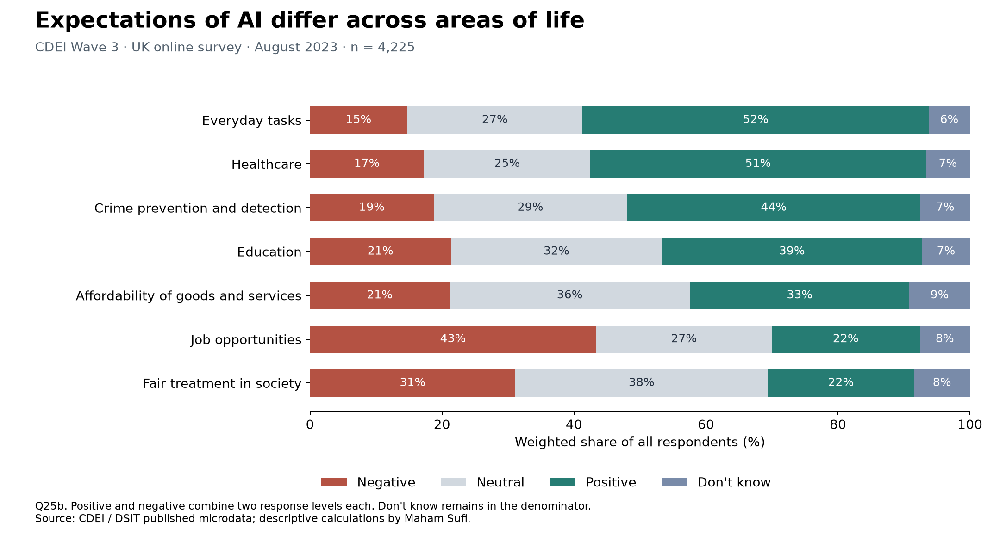
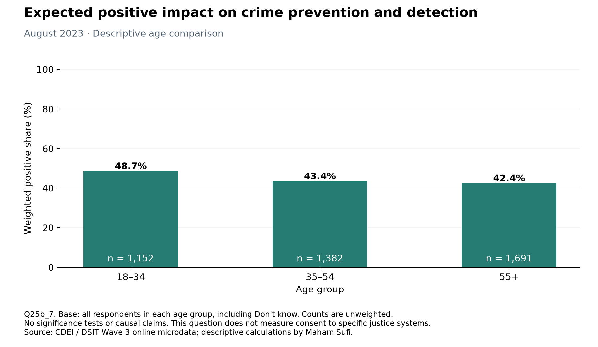

# Public attitudes to AI and public services

A reproducible Python analysis of public attitudes to AI and public services by **Maham Sufi**, using the UK government's public CDEI / DSIT Wave 3 survey data.

## Research questions

1. How do expectations of AI's impact differ across areas of life?
2. How does the share expecting a positive impact on crime prevention and detection differ by age?

The project uses **4,225 individual online survey responses collected in August 2023**. It applies the supplied survey weights. The separate telephone sample is excluded. These historical data are useful for a reproducible methods exercise, not a claim about current public opinion.

## Results

Read [the findings and limitations](outputs/FINDINGS.md).





## Run the project

Python 3.12 was used. From the project folder:

```bash
python3 -m venv .venv
source .venv/bin/activate
python -m pip install -r requirements.txt
python download_data.py
python -m unittest discover -s tests -v
python analysis.py
```

On Windows, activate with `.venv\Scripts\activate` instead. The download requires internet access; analysis runs offline once the two files are present. Four direct dependencies are pinned to the tested versions. This is not a complete transitive dependency lock.

To reuse an existing local environment, run `.venv/bin/python analysis.py` from the project folder. Create a fresh environment when setting up the project on another computer.

## Analysis workflow

- Reading Excel microdata and the question dictionary with pandas.
- Selecting a small set of relevant variables and standardising whitespace.
- Detecting duplicate IDs, invalid weights and unexpected response labels.
- Keeping `Don't know` distinct from blank responses, with no imputation.
- Combining positive and negative response levels and computing weighted percentages.
- Comparing weighted and unweighted values, with explicit subgroup denominators.
- Creating two Matplotlib charts and machine-readable summary tables.
- Testing calculations on deliberately small examples and checking results against official tables.

The [analysis walkthrough](LEARNING_GUIDE.md) explains the calculations, checks and possible extensions.

## Method in one calculation

For any group:

```text
weighted percentage = 100 × sum(weights for the chosen response) / sum(weights for everyone in the group)
```

`Very positive` and `Slightly positive` become `Positive`. `Very negative` and `Slightly negative` become `Negative`. Neutral and `Don't know` remain separate. A genuinely blank answer becomes `Missing` and stays in the denominator. The selected questions contain no blank answers in this release; missing-value behaviour is demonstrated in tests, not presented as a cleaning problem found in the survey.

The three age groups are made from the source's age bands. A subgroup's base is that subgroup, not the whole dataset. Weighted totals can be fractional; displayed `n` values are actual respondent counts.

No regression, causal estimates, confidence intervals or significance tests are attempted. Weighting alone does not remove selection bias from an online quota sample. The crime item asks about expected impact, not consent to a specific justice AI system or experiences of justice service users.

## Verification and outputs

The run checks 21 published percentages from official Tables 106 and 113–119. Because those tables use whole percentages, the allowed rounding difference is 0.51 percentage points. This is an arithmetic tolerance, not a confidence interval.

| File | Purpose |
|---|---|
| `analysis.py` | Cleaning, calculations, source checks, charts and report |
| `download_data.py` | Download and fingerprint-check the two official workbooks |
| `tests/test_analysis.py` | Seven checks of meaningful failure modes |
| `data/sources.json` | Source URLs, retrieval date and SHA-256 fingerprints |
| `outputs/selected_variable_dictionary.csv` | Exact labels for the selected variables |
| `outputs/domain_distribution.csv` | Counts and weighted/unweighted percentages by domain |
| `outputs/crime_by_age.csv` | Crime expectations by age group |
| `outputs/ai_awareness.csv` | Self-reported AI awareness distribution |
| `outputs/official_checks.csv` | Calculations alongside published benchmarks |
| `outputs/quality_audit.json` | Row counts, weights, missingness and checks |

Raw source workbooks are downloaded from the publisher and excluded from Git. Generated outputs contain aggregate data only. No thesis, UNDP internal files, CV, contact information or application materials are included in this repository.

## Sources and reuse

Data: CDEI / Department for Science, Innovation and Technology, research conducted by Savanta, [Public attitudes to data and AI: Tracker survey (Wave 3)](https://www.gov.uk/government/publications/public-attitudes-to-data-and-ai-tracker-survey-wave-3). [Methods and published report](https://www.gov.uk/government/publications/public-attitudes-to-data-and-ai-tracker-survey-wave-3/public-attitudes-to-data-and-ai-tracker-survey-wave-3).

Contains public sector information licensed under the [Open Government Licence v3.0](https://www.nationalarchives.gov.uk/doc/open-government-licence/version/3/), except where otherwise stated by the publisher. Attribution does not imply government endorsement. Code is available under the [MIT licence](LICENSE); that licence does not replace the source data's terms.

## Project documentation

See the [analysis walkthrough](LEARNING_GUIDE.md) for methods and extension ideas, the [review log template](REVIEW_LOG.md) for recording future updates, and [GitHub setup instructions](GITHUB_SETUP.md) for repository maintenance.
